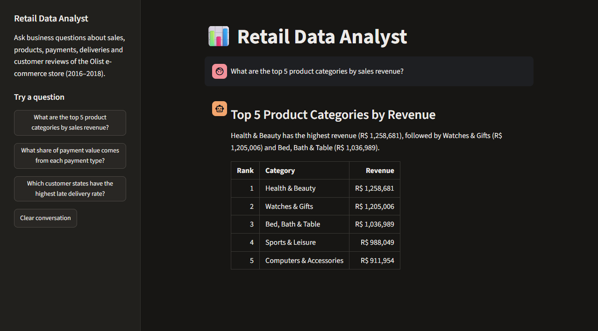
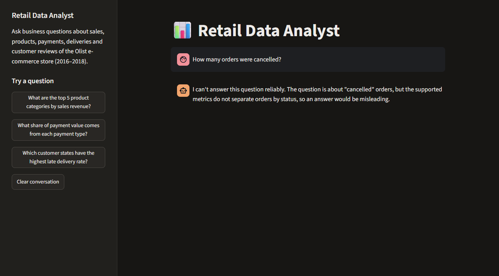

# Agentic Retail Data Analyst

A local, multi-agent AI analyst that answers business questions in plain English about a retail
(e-commerce) database, for example *"What share of payment value comes from each payment type?"*.
Three cooperating agents, built with **LangGraph**, plan the work, fetch verified business metrics
from **PostgreSQL**, run statistics with **pandas** and report an answer that is generated from the
data. Everything runs locally on a laptop with a 2 GB GPU, using **Qwen 2.5 1.5B via Ollama**, at zero cost.

> **Status: experimental portfolio project; the core implementation is frozen.**
>
> - **Final regression:** 0 wrong answers on all three evaluation sets (17, 32 and 49 questions). Of the answerable
>   questions, 13 of 13, 13 of 18 and 1 of 4 were answered correctly; all other questions were refused.
> - **Limited coverage:** the system only answers questions its metric catalog can express (11 metrics and 6 groupings,
>   in 30 valid combinations) and refuses everything else. Only 4 of 49 questions written without knowledge of the
>   catalog fall within it.
> - **No independent validation:** all three question sets were used during development.
> - **Not production-ready:** it does not do general-purpose SQL reasoning.

## Motivation

A small local model (Qwen 2.5 1.5B, running on a 2 GB GPU) is cheap and private, but it can't be trusted to write SQL against a 20-table warehouse or to describe the results. In early versions of this project it chose wrong tables and columns, and its written summaries contained false superlatives. The result was plausible-looking but unreliable answers (see Development history).

This project therefore limits what the model decides:
- **The model makes only constrained choices:** which catalog metric and grouping fit the question, and, occasionally, which agent runs next.
- **Deterministic code does the rest:** it reads years, "top N" and the type of calculation from the question, compiles the SQL from verified metric definitions, validates it, and runs it through a read-only login. It also performs the analysis and writes the answer text from the returned rows.
- **Safe refusal is a deliberate outcome, not a failure:** when a question falls outside what the catalog can express, the system says so and explains why, rather than answering a different question.

## What you can ask

The assistant is **intentionally scoped**: it answers questions that map to one metric of its catalog, optionally grouped one way. It does not support arbitrary analytical questions.

| Metric | Meaning | Can be grouped by |
|---|---|---|
| Revenue | item prices, excluding freight (BRL) | product category, seller state, customer state, month |
| Units sold | number of product units sold | product category, seller state, customer state, month |
| Freight | freight (shipping) charges (BRL) | product category, seller state, customer state, month |
| Orders | number of orders | customer state, month |
| Customers | number of distinct customers | customer state, month |
| Average order value | average item value per order (BRL) | customer state, month |
| Late delivery rate | share of delivered orders that arrived after the estimated date | customer state, month |
| Average delivery days | average days from purchase to delivery | customer state, month |
| Payment value | amount customers paid, including freight (BRL); not revenue | payment method, month |
| Average review score | average customer review score (1–5 stars) | customer state, month, delivery status (late vs on time) |
| Reviews | number of customer reviews | customer state, month, delivery status (late vs on time) |

These are **11 metrics and 6 groupings, combined in only the 30 valid pairs listed above**, not all 66 possible pairs. For example, payments can't be grouped by product category, because a payment can't be attributed to individual products. Every metric can also be asked for as an overall total. Within these combinations, a question can:
- restrict the data to a year (2016–2018),
- ask for the top or bottom N,
- ask for each group's share of the total,
- ask for month-over-month growth.

**Examples that are answered:**
- *What are the top 5 product categories by sales revenue?*
- *What share of payment value comes from each payment type?*
- *Which customer states have the highest late delivery rate?*
- *How did monthly sales revenue grow during 2018?*

**Examples that are refused**, with the reason shown to the user:
- *How many orders were cancelled?* The catalog doesn't separate orders by status, so counting all orders would answer a different question.
- *Which sellers generate the most revenue?* Individual sellers aren't in the catalog; only seller states are.

### Screenshots

An answered question, with a summary and a results table generated from the data:



A safe refusal that explains why the question can't be answered reliably:



## Tech stack

| Component | Choice |
|---|---|
| LLM | `qwen2.5:1.5b` via **Ollama** (local, free) for all three agents |
| Orchestration | **LangGraph** (`StateGraph` with shared `TypedDict` state) + `langchain-ollama` |
| Database | **PostgreSQL 18**, database `retail_intelligence` (Olist e-commerce data) |
| DB access | **SQLAlchemy** + **psycopg 3**, read-only login `retail_agent_ro` |
| Analysis | **pandas** (a fixed allowlist of operations) |
| UI | **Streamlit** chat |
| Tests | Python `unittest` + Streamlit `AppTest` (no extra dependencies) |

## Architecture: three agents

```
                 ┌───────────────────────────────────────────────┐
  question ───▶  │ Supervisor (Qwen 1.5B)                        │
                 │ refuses unanswerable questions; decides the   │
                 │ next step; code validates every decision      │
                 └──────┬─────────────────▲──────────┬───────────┘
                        │                 │ results  │ enough evidence
           ┌────────────┴───────┐   ┌─────┴──────────┴───┐      ▼
           ▼                    │   │                    │  Supervisor: report stage
  ┌──────────────────┐          │   │  ┌───────────────┐ │  reliability checks +
  │ Data Analyst     │──────────┘   └──│ Analytics     │ │  answer generated by code
  │ picks ONE metric │                 │ ONE allowlisted│ │  from the verified data
  │ + grouping; code │◀── "need more ──│ pandas op as   │─┘
  │ compiles the SQL │     data"       │ JSON           │
  └──────────────────┘   (via Supervisor) └───────────────┘
```

| Agent | Responsibility | Decides | Never does |
|---|---|---|---|
| **Supervisor** | Coordinates; final report stage (not a fourth agent) | Next agent (`data_analyst`, `analytics`, `report`) and the task text | Query data; write the answer text |
| **Data Analyst** | Fetches data | ONE metric and ONE grouping from the verified **metric catalog**, as JSON (or `null`: no metric fits, so the question is refused) | Write SQL or choose tables/columns. Code compiles verified definitions. |
| **Analytics** | Extra calculations | One of 6 operations (`group_sum`, `top_n`, `mean_median`, `share_of_total`, `growth`, `correlation`), or "I need more data" | Write or run code; re-analyse data whose ranking/share/growth is already computed |

**Workflow** (`retail_analyst/graph.py`): `START → supervisor → {data_analyst | analytics | report}`.
Both specialists always return to the Supervisor, and `report → END`.

**What code decides, not a model:**
- **Explicit constraints** (`question.py`): years, "top N", highest/lowest and the type of calculation (ranking, share, growth).
- **Refusals before any agent runs:** why-questions, forecasts, relative periods such as "last quarter", and years without data.
  Also refused: **qualifiers and filters the catalog can't represent**:
  - order status (cancelled, returned)
  - customer type (new, returning)
  - event dates (reviews received, written)
  - popularity and best/worst without a measure
  - daily, weekly or quarterly grouping
  - one specific month, state, payment method or category used as a filter

  Each refusal states its reason.
- **Closed-world check** (`catalog.unexplained_words`, applied before any agent): every word of the question must be accounted for by one of:
  - a metric or grouping term
  - a recognised constraint (years, numbers, ranking, share, trend, date ranges)
  - a short list of generic words

  Anything else ("estimated", "…with more than one payment method used", "unique products", "before 2018", "higher than") is refused, naming the word.
  This targets the whole class of *silently ignored conditions* found by the fresh question set, rather than adding one word at a time.
- **Date ranges:** "from September 2016 to October 2018" covers the whole dataset and means no filter; whole calendar years become a year filter;
  partial ranges and endpoint comparisons ("percentage increase from … to …") are refused.
- **SQL** (`catalog.py`): compiled from 11 verified metric definitions and 6 groupings. Rankings, shares and month-by-month growth are calculated in SQL.
- **The answer text and table** (`summary.py`): every superlative, "followed by", largest increase or decrease, and overall change is computed from the rows.

**Routing:** the Supervisor asks its model only when there's a real choice. In every other case the next step follows from rules, without a model call:
- **No data yet:** the Data Analyst runs, with the user's question as its task. Model-written tasks were observed inventing periods and groupings.
- **A second data request** only happens when Analytics asks for more data. Identical second requests were observed in the benchmark.
- **The Data Analyst stopped** because it kept repeating a failed request: no second call; the report follows.
- **Analytics** is only offered when the question asks for a calculation the catalog doesn't provide (correlation, median, variance), and never for data whose ranking, share or growth is already calculated.
- **When the model does decide,** an invalid choice falls back to a rule, and a vague task is replaced with one built from the question.

So most questions use **one model call in total**: the Data Analyst's choice.

**Termination:**
- at most 6 routing steps
- 2 Data Analyst calls and 2 Analytics calls per question
- 3 query attempts per Data Analyst call; repeats of failed requests are never run
- a LangGraph recursion limit as a final backstop

## Safety and reliability layers

1. **Database login:** `retail_agent_ro` has `SELECT` only, on 20 business tables, and no other rights.
   - Sessions are read-only, with a 30 s statement timeout and a 5-connection limit.
   - See `sql/02_create_agent_role.sql`.
2. **Metric catalog and question constraints** (`catalog.py`, `question.py`):
   - 11 business metrics and 6 groupings, in 30 valid metric–grouping combinations (plus an overall total for each metric),
     defined from the warehouse facts using the database's documented rules:
     - revenue excludes freight
     - payments can't be attributed to products or sellers
     - delivery metrics use the documented "eligible" delivered orders
     - monthly series stay within the reliable window, 2017-01 to 2018-08
   - Each definition is tested to reproduce the documented views exactly.
   - The model only picks a metric and a grouping, and **that choice must fit the question's wording** (`check_fit`).
     Every metric and grouping has a list of business terms ("sales" → revenue, "seller state" → seller state), and the more specific term wins ("units sold" counts as units, not revenue).
     Code rejects a choice whose metric isn't mentioned in the question, whose grouping isn't asked for, or which leaves out a grouping the question asks for.
     The error names what the question does mention, so a retry can fix it; otherwise the question is refused.
   - The earlier free-form query builder (`tools/query_builder.py`) is kept and tested, but it isn't used to answer users.
3. **SQL validator** (`tools/sql_tool.py`): a single `SELECT`/`WITH` statement only, no write or DDL keywords, no dangerous functions, and at most 500 rows. It also checks the generated SQL (defence in depth).
4. **Analysis allowlist** (`tools/python_tool.py`): 6 hand-written pandas operations with validated parameters. There's no `eval` or `exec`, and already-calculated percentages can't be summed or grown again.
5. **Reliability gate before the user sees anything** (`ui_support.py`). The report stage classifies every check:
   - **scope** (the question can't be answered from the data): a refusal that states its reason.
   - **data** (no data, repeated labels from wrong grouping, truncated data, step limit, or a question naming a year while the data is neither filtered to it nor contains it): a short "couldn't produce a reliable answer" message.
   - **info** (automatic corrections, earlier failed attempts): logged only.
6. **No model-written answer text** (`summary.py`): the user sees a heading, one or two factual sentences and a results table, all generated from the verified rows. In the benchmark, model-written summaries contained false statements in 6 of 13 answers, so the model's text is no longer used.

## Data

`retail_intelligence` holds the public **Olist Brazilian e-commerce** dataset (about 99k orders, 2016–2018). It is built by
the companion project [retail-intelligence](https://github.com/eliechahoud7/retail-intelligence) (see Setup, step 2):
- **`warehouse`:** a star schema (4 fact and 4 dimension tables with foreign keys).
- **`analytics`:** 7 reporting views.
- **`dbt_marts`:** 5 summary tables.

The catalog's metrics are built from the `warehouse` facts and checked against the `analytics` views.

## Project structure

```
agentic-retail-analyst/
├── app.py                       # Streamlit chat UI
├── retail_analyst/
│   ├── config.py                # .env settings, read-only engine, schema metadata, LLM factory
│   ├── state.py                 # shared LangGraph state + workflow limits
│   ├── prompts.py               # prompts for the Supervisor, Data Analyst and Analytics agents
│   ├── catalog.py               # metric catalog: verified business metrics and groupings -> SQL
│   ├── question.py              # years, top N, direction, calculation and refusals read from the question
│   ├── summary.py               # answer heading, factual summary and table, generated from the data
│   ├── labels.py                # readable category and label names
│   ├── graph.py                 # LangGraph wiring; CLI: python -m retail_analyst.graph "question"
│   ├── ui_support.py            # reliability gate, service checks, diagnostics
│   ├── agents/                  # supervisor.py (routing + report), data_analyst.py, analytics.py
│   └── tools/                   # sql_tool.py, python_tool.py, query_builder.py (kept, not used)
├── sql/                         # read-only login script and a read-only schema inspection script
├── docs/images/                 # README screenshots
├── evaluation/                  # benchmark.json, run_benchmark.py, ground truth, all result files
├── tests/                       # 164 tests (catalog, fit check, question parsing, tools, graph, summaries, UI, benchmark reference)
├── .env.example                 # configuration template (copy to .env)
└── requirements.txt
```

## Setup and running

All commands are for **Windows PowerShell**. Follow the steps in order.

### 1. Prerequisites

| Software | Tested version |
|---|---|
| Windows | Windows 11 Pro (build 10.0.26200) |
| Python | 3.12.10 |
| PostgreSQL | 18 |
| Ollama | 0.40.16, with `qwen2.5:1.5b` (about 1 GB) |
| Git | 2.47 |

**Tested hardware:** NVIDIA MX450 (2 GB) and 16 GB RAM. Other setups haven't been tested.

### 2. Build the `retail_intelligence` database (companion project)

**Prerequisite:** this project only **reads** an existing PostgreSQL database. That database is built by the companion project **[retail-intelligence](https://github.com/eliechahoud7/retail-intelligence)**, which provides:
- the Olist data pipeline,
- the `warehouse` star schema,
- the `analytics` views,
- the `dbt_marts` tables.

Clone it and follow **its** *Getting started* steps 1–5, **including step 5 (dbt)**. Run those commands in the `retail-intelligence` folder, with that project's own virtual environments (`.venv` and `.venv-dbt`), which it creates itself. Its steps include downloading the [Olist dataset](https://www.kaggle.com/datasets/olistbr/brazilian-ecommerce) from Kaggle.

```powershell
git clone https://github.com/eliechahoud7/retail-intelligence.git
# then follow retail-intelligence\README.md, "Getting started", steps 1-5
```

All three schemas are required:
- `02_create_agent_role.sql` (step 3) grants access to `warehouse`, `analytics` and `dbt_marts`.
- The tests and ground-truth queries use the `analytics` views.

**Check the database** with `psql` as the PostgreSQL admin. No Python environment is needed. `psql` is usually not on PATH, so use its full path, and adjust `18` if your PostgreSQL version differs:

```powershell
$psql = "C:\Program Files\PostgreSQL\18\bin\psql.exe"
& $psql -U postgres -d retail_intelligence -c "SELECT COUNT(*) FROM warehouse.fact_orders;"   # expect 99441
& $psql -U postgres -d retail_intelligence -c "\dn"                                            # expect warehouse, analytics, dbt_marts
```

### 3. Create the read-only login `retail_agent_ro`

Get this repository and open PowerShell in its root folder; all later commands run there.

The script creates a login with:
- `SELECT` on 20 business tables only,
- read-only sessions,
- a 30 s timeout,
- a 5-connection limit.

It contains **no password**. You choose the password interactively at the `psql` prompt, so it never appears in a command or a file.

```powershell
$psql = "C:\Program Files\PostgreSQL\18\bin\psql.exe"            # same as step 2 (needed in a new window)
& $psql -U postgres -d retail_intelligence -f sql\02_create_agent_role.sql
& $psql -U postgres -d retail_intelligence
# at the psql prompt:
#   \password retail_agent_ro        (enter the new password twice; it is not shown)
#   \q
```

### 4. Python environment

```powershell
py -3.12 -m venv .venv
Set-ExecutionPolicy -Scope CurrentUser RemoteSigned            # only if running scripts is blocked
.\.venv\Scripts\Activate.ps1
python -m pip install -r requirements.txt
```

The `python` commands in steps 7–9 assume this environment is active. In a new PowerShell window, run `.\.venv\Scripts\Activate.ps1` again.

### 5. Configure `.env`

```powershell
Copy-Item .env.example .env
notepad .env                      # set PGPASSWORD to the password chosen in step 3
```

- `.env` is git-ignored: **never commit it**. The other values (host, port, database, `PGUSER=retail_agent_ro`, Ollama URL and model) are already correct for a local setup.
- **⚠ Variables already set in your shell take precedence over `.env`.** If `PGUSER` or `PGPASSWORD` is set (common when using `psql` as admin), the application would connect with those credentials instead of `retail_agent_ro`. Check, and clear them for the current session:

```powershell
Get-ChildItem Env:PG*                                            # should list nothing
Remove-Item Env:PGUSER, Env:PGPASSWORD -ErrorAction SilentlyContinue
```

### 6. Ollama and the model

1. Install Ollama from [ollama.com/download](https://ollama.com/download). It runs in the background at `http://localhost:11434`.
2. Download the model:

```powershell
ollama pull qwen2.5:1.5b
ollama list                       # qwen2.5:1.5b must be listed
```

- All three agents use `OLLAMA_MODEL`.
- The optional `SUPERVISOR_MODEL`, `DATA_ANALYST_MODEL` and `ANALYTICS_MODEL` settings override it per agent. All evaluation results were produced with `qwen2.5:1.5b`.

### 7. Run

```powershell
python -m retail_analyst.graph "What share of payment value comes from each payment type?"   # command-line check
streamlit run app.py                                                                       # chat UI at http://localhost:8501
```

**The command-line check** prints the agent trace (requests and generated SQL), then the answer with its evidence and caveats.
- **Expected:** credit card 78.34% of payment value.
- If settings are missing, the error lists their names.

**The chat** shows **only the business answer** (a heading, a factual summary and a results table) or a short refusal with its reason.
- If the database or the model can't be reached, it shows an "unavailable" notice instead.
- Each question's diagnostics (outcome, timing, checks and the full agent trace) are written to the application log.

### 8. Tests

```powershell
python -m unittest discover -s tests
```

164 tests, about 20 s. **The database is required**; Ollama is not, because the model replies are scripted in the tests.

### 9. Benchmark

The benchmark needs both the database and Ollama.

```powershell
python evaluation\run_benchmark.py my_run_17q                               # benchmark.json (17 questions)
python evaluation\run_benchmark.py my_run_32q independent_questions.json    # 32 questions
python evaluation\run_benchmark.py my_run_49q fresh_questions.json          # 49 questions
```

- **Output:** results go to `evaluation\results\<label>.json` and `.txt`.
- **Labels:** **use a new label**, because an existing label is overwritten. A label containing a folder (`my_run\results`) needs that folder to exist first.
- **Runtime:** each set takes about **12–25 s** on the tested hardware; the first question includes loading the model.

### Troubleshooting

| Symptom | Cause |
|---|---|
| `Missing settings in .env: …` | `.env` is missing or incomplete (step 5) |
| "Unavailable" notice in the app | PostgreSQL isn't running, the password in `.env` is wrong, Ollama isn't running, or the model hasn't been downloaded |
| `psql` not recognised | Use the full path (step 2) |
| Login script fails with `schema "dbt_marts" does not exist` | The dbt step of the database build is missing (step 2) |
| `Activate.ps1 cannot be loaded because running scripts is disabled` | Run the `Set-ExecutionPolicy` line (step 4) |

## Evaluation

### Methodology

**Question sets** (`evaluation/`):

| Set | Questions | Written by | Answerable / must refuse |
|---|---|---|---|
| `benchmark.json` | 17 | the catalog's developer | 13 / 4 |
| `independent_questions.json` | 32 | the catalog's developer, phrased as a business manager would ask. Despite the file name, **not independent** | 18 / 14 |
| `fresh_questions.json` | 49 | generated by `qwen2.5:3b` without access to the catalog (prompt and raw output in `fresh_questions_raw.json`); then used during development | 4 / 45 |

- **Ground truth:** hand-written SQL that doesn't use the catalog, mostly through the database's documented views, following each question's natural meaning.
- **Must-refuse questions:** causes, forecasts, relative periods, data the database doesn't hold, and questions the catalog can't express correctly.
- **Runner:** `evaluation/run_benchmark.py` runs every question through the real workflow (live model and database) and scores **what the user would see**.

**Scoring outcomes:**

| Outcome | Meaning |
|---|---|
| **Correct answer** | An answerable question was answered, and the data shown matches the ground truth (groups, values and, for rankings, order) |
| **Wrong answer** | An answer was shown, but it doesn't match the ground truth, or the question should have been refused (`wrong` and `wrongly_answered` in the result files) |
| **Correct refusal** | A must-refuse question was refused |
| **Safe failure** | An answerable question was refused: no answer, but nothing false shown |

**Derived figures:**
- **Accuracy on answerable questions** = correct answers / answerable questions.
- **Refusal precision** = correct refusals / all refusals.

Answers were also checked by hand against the ground truth, not only by the automatic scoring.

> **⚠ None of these sets is independent validation.**
> - The 17- and 32-question sets were written by the catalog's developer.
> - The 49-question set was generated by Qwen 2.5 3B without access to the catalog, but it was then used during development.
> - Failures found in all three sets led to fixes, and some catalog terms were taken from their wording.
>
> The results show that the final implementation is **stable and safe on these known questions**, not how it generalises
> to new ones.

### Final results (frozen implementation)

| | 17 questions | 32 questions | 49 questions |
|---|---|---|---|
| Run (`evaluation/results/`) | `freeze_17q/` | `freeze_32q/` | `yearfix_49q/` |
| Correct answers | 13 | 13 | 1 |
| **Wrong answers** | **0** | **0** | **0** |
| Correct refusals | 4 | 14 | 45 |
| Safe failures | 0 | 5 | 3 |
| Accuracy on answerable questions | 13/13 = 100% | 13/18 = 72.2% | 1/4 = 25% |
| Refusal precision | 4/4 = 100% | 14/19 = 73.7% | 45/48 = 93.8% |
| Total time | 12.5 s | 21.3 s | 16.2 s |

All runs used `qwen2.5:1.5b` for every agent, on the tested hardware (see Setup).

**The safe failures, explained:**
- **32 questions:**
  - **4 deliberate traps** (new customers, "most popular", "worst reviews", reviews received): a plausible answer would be wrong, so refusing them is the intended behaviour.
  - **"Do late deliveries *hurt* customer ratings?"** is refused by the closed-world check, which doesn't know "hurt".
- **49 questions:**
  - **"Revenue from each payment method":** the model insisted on an invalid combination.
  - **"…average number of days…order placement"** and **"…Is there an improvement…":** refused by the closed-world check because of words it doesn't know.

**Coverage:** only 4 of the 49 catalog-blind questions fall within the catalog. Most realistic questions are therefore refused, by design.

### Development history

The runs below document how the final version was reached. **Each describes an earlier version**; the final results above supersede them.
All result files are kept in `evaluation/results/`, indexed in its `README.md`.

#### 1. Five-question set: from free-form SQL to the metric catalog (`evaluation/ground_truth.sql`)

Outcomes for these runs were scored by hand at the time; the result files store timings, traces and answers, but no outcome field.

| Version | Correct | Wrong | Safe failure | Time per question |
|---|---|---|---|---|
| Free-form SQL (first version) | 0 | 0 | 4 | 31–71 s |
| Free-form SQL + retry/prompt fixes | 0 | 0 | 5 | 54–124 s |
| Structured JSON queries | 0 | **2** (Q1, Q4: wrong grouping) | 3 | 31–46 s |
| Structured + automatic correction + repeated-labels check | 2 (Q1, Q4) | 0 | 3 | 26–30 s |
| Same, but **3B** Data Analyst | 0 | 0 | 5 | 83–137 s |
| Metric catalog + generated summaries + fit check and fewer calls (questions 1–5 of the 17-question run 3) | **5** | **0** | **0** | 0.7–3.2 s |

In the first version, Q1 is counted as neither correct nor wrong: its numbers were right, but it used "$" and wrong ranking words.

**Model choice:** `qwen2.5:1.5b` is used for all three agents. In the structured-query comparison (one five-question
run each), the 3B Data Analyst compared with 1.5B as follows:
- **Speed:** about 4× slower, 550 s against 138 s in total.
- **Hardware use:** it ran 62% on the CPU and only 38% on the 2 GB GPU, while the 1.5B model ran 76% on the GPU.
- **Failures:** its requests failed validation 15 times against 4, and it produced no successful query, against 2.

**What made the difference:** the earlier versions asked the 1.5B model to choose among 20 tables and
301 columns, and it chose wrongly most of the time while ignoring error feedback. The catalog reduced
that to a closed choice of metric and grouping, and moved the business rules, constraints, calculations
and answer text into tested code.

#### 2. 17-question benchmark: catalog versions, runs 1–3 (`catalog_1.5b`, `catalog_generated_1.5b`, `catalog_p3p4_1.5b`)

| | Run 1: model-written summaries | Run 2: generated summaries | Run 3: + fit check and fewer calls |
|---|---|---|---|
| Correct metric and grouping chosen by the Data Analyst | 13/13 | 13/13 (identical requests to run 1) | 13/13 |
| Answer **data** correct | 13/13 | 13/13 | 13/13 |
| Answer **text** free of false statements | 7/13 | 13/13 | 13/13 (identical text to run 2) |
| Wrong answers | 0 | 0 | 0 |
| Must-refuse questions refused | 4/4 | 4/4 | 4/4 |
| Time per answered question | 24–63 s | 3–16 s (no report model call) | 0.6–3.2 s (usually one model call) |
| Refusals | instant, except the marketing question (19 s) | instant, except the marketing question (16 s) | instant, except the marketing question (4.5 s) |
| Total for all 17 questions | 485 s | 122 s | 17.6 s |
| Memory | 1.1 GB, 76% on GPU; 844 of 2,048 MiB in use | same | same |

- **Run 1:** the model-written summaries contained false statements in Q2, Q3, Q7, Q8, Q12 and Q13, for example "highest growth in February" when it was March, and "lowest in RO" when it was SP. That led to the generated summaries.
- **Run 2:** an offline rescore of run 1's requests with the generated summaries (`catalog_1.5b_generated_summaries.json`) was confirmed by this live run. Every answer sentence was checked by hand against the ground truth.
- **Reference test:** `tests/test_benchmark_reference.py` shows that, given the correct metric choice, the code reproduces all 13 ground-truth answers.
- **In these runs, the marketing question was refused for a lucky reason.** The model didn't recognise it as out of scope; it chose an invalid combination (`customers` by `payment_type`), which the catalog rejected. In the final version it is refused by rules before any agent runs.

#### 3. First run of the 32-question set (`independent_1.5b`)

| Question type | Count | Result |
|---|---|---|
| Within the catalog, normal wording | 9 | **9 correct** |
| Within the catalog, unusual wording ("takings", "earns", "wait the longest", …) | 5 | 5 refused (safe, but missed). In 4 of them the model chose correctly, and the fit check rejected the choice because the words weren't in its term lists. |
| Traps where a plausible answer is wrong | 4 | **4 wrong answers** (details below) |
| Data exists but the catalog can't answer | 9 | 8 refused, **1 wrong answer** |
| Impossible (profit, marketing, stock, forecast, causes) | 5 | 5 refused |

**The 5 wrong answers all ignored a qualifier in the question that the catalog can't represent:**
- **"How many orders were *cancelled*?"** was answered with all orders (99,441).
- **"*New* customers each month"** was answered with active customers.
- **"Month with the *worst* reviews"** was answered with the number of reviews, highest first.
- **"Reviews *received* in 2018"** was counted by purchase date (53,854) instead of review date (56,164).
- **"Most *popular* payment method"** was ranked by payment value instead of the number of payments. The leader (credit card) was still right.

The fit check is what refused the questions about one state or one payment type (São Paulo, Rio de Janeiro, vouchers) and profit margins. Without it, they would have been answered with unrelated totals.

**This led to qualifier and filter detection** (`question.py`). In an offline rescore, all 5 wrong answers became refusals: **9 correct, 0 wrong, 14 correct refusals, 9 safe failures** (5 unusual wording + 4 traps).

#### 4. Live regression after qualifier detection (`final_regression_17q/`, `final_regression_32q/`, `final_regression_checks/`)

| | 17 questions | 32 questions |
|---|---|---|
| Correct / **wrong** / correct refusals / safe failures | 13 / **0** / 4 / 0 | 9 / **0** / 14 / 9 |
| Accuracy on answerable questions | 100% | 50%, but 100% of the answers given |
| Refusal precision | 100% | 60.9% |
| Total / average time | 21.2 s / 1.25 s (0.59 s after model warm-up) | 45.2 s / 1.41 s |

**Special checks:**
- **Correct:** "Which states receive the most orders?" was answered; "reviews received in 2018" and "new customers acquired in 2017" were refused.
- **Unnecessary refusals:**
  - "Which categories receive the most orders?": orders per category isn't in the catalog.
  - "Which are the best-selling categories?": the fit check didn't know "best-selling".

#### 5. Synonym groups in the fit check (`synonyms_17q/`, `synonyms_32q/`)

General wording for selling and buying, earning, waiting and lateness was added to the term lists.

| | 17 questions | 32 questions |
|---|---|---|
| Correct / **wrong** / correct refusals / safe failures | 13 / **0** / 4 / 0 | 14 / **0** / 14 / 4 |
| Total / average time | 20.3 s / 1.19 s | 34.0 s / 1.06 s |

- **The 5 newly correct answers** were Q4, Q5, Q7, Q14 and Q17 ("buy the most products", "takings", "earns", "wait the longest", "after the promised date").
- **These gains are contaminated:** their words were taken from this set, so they aren't independent evidence.

#### 6. First run of the fresh 49-question set (`fresh_49q/`)

**Classification of the set:**
- **4 questions** the catalog can answer.
- **37 coverage gaps:** the data exists, but the catalog can't express the question.
- **8 impossible questions:** the data doesn't exist.

**Result:** 0 correct, **2 wrong**, 43 correct refusals and 4 safe failures, in 35.7 s.

**The 2 wrong answers:**
- **"Average delivery duration from order placement to the *estimated* delivery date"** was answered with the actual delivery time (12.56 days); the correct figure is 23.77 days. The term "delivery duration" had been **added in the synonym change**.
- **"Total revenue from orders *with more than one payment method*"** was answered with total revenue (R$ 13,591,644); the correct figure is R$ 284,488 from 2,246 orders. The condition was ignored.

**The 4 unnecessary refusals:**
- **3 questions** said "during the period September 2016 to October 2018" (the whole dataset), and the single-month rule mistook it for one month.
- **1 question** used wording that wasn't in the term lists.

**Lesson:** conditions the term lists don't recognise could still be ignored silently, and widening the lists had made this worse in one case.

#### 7. Closed-world check and date ranges (`closedworld_17q/`, `closedworld_32q/`, `closedworld_49q/`)

| | 17 questions | 32 questions | 49 questions |
|---|---|---|---|
| Correct / **wrong** / correct refusals / safe failures | 13 / **0** / 4 / 0 | 13 / **0** / 14 / 5 | 0 / **0** / 45 / 4 |
| Total / average time | 20.5 s / 1.21 s | 20.7 s / 0.65 s | 16.5 s / 0.34 s |

- **49 questions:** the 2 wrong answers became correct refusals.
- **32 questions:** "Do late deliveries hurt customer ratings?" became an unnecessary refusal (the closed-world check doesn't know "hurt").
- **Bug found:** fresh Q3 retrieved the correct data, but the report stage's year check still read 2016 and 2018 from the raw question instead of applying the range rule. It flagged the data as "a different period" and refused. The result was safe, but it was a bug.

#### 8. Year-check fix (`yearfix_49q/`)

The year check now reads date ranges with `question.read_ranges`, like the question rules, and regression tests cover fresh Q3's wording end to end.
- **The only change:** Q3 is now answered correctly. SP has the most orders (41,746), followed by RJ (12,852) and MG (11,635).
- This run is the 49-question figure in the final results. The 17- and 32-question sets contain no date ranges, and their final runs (`freeze_17q/`, `freeze_32q/`) gave results identical to step 7.

## Known limitations

- **The closed-world check trades coverage for safety.** Any unlisted word leads to a refusal: "Do late deliveries *hurt* customer
  ratings?" (answered correctly before) and "average number of days for an order to be delivered" are now refused.
  Every addition to the generic word list is a decision with consequences: a word that can introduce a condition must not be added.
- **Qualifier detection uses word lists.** It refuses meaning-changing words (cancelled, new, worst, received, …) and
  value filters (one state, month, payment method or category). That turned the 32-question set's 5 wrong answers into refusals.
  Words are checked in context: "new" only counts in lifecycle phrases such as "new customers", and "receive" only
  for reviews or ratings received, or deliveries customers received ("Which states receive the most orders?" is answered).
  A qualifier phrased in words not on the lists could still be ignored, and a harmless question can still be over-refused.

- **Fixed scope:** only the catalog's 11 metrics and 6 groupings (30 valid combinations), one grouping per question. Questions like
  "growth per category", or ones about products, sellers or customers individually, are refused.
- **The fit check depends on its term lists.** A question that names a metric in words not on the list
  is refused rather than answered. The lists were widened with synonym groups, partly from the evaluation sets
  (see Development history, step 5), and "products" alone and "spend" are deliberately left out. Ambiguous
  questions such as "How many orders were late?" can still pass with a valid but imprecise metric (total orders).
- **The Data Analyst's choice is still made by the model.** In the benchmark it chose correctly 13/13, but it
  usually ignores error feedback, so a wrong first choice tends to end in a refusal rather than a correction.
- **Fixed wording:** the generated summaries are accurate but formulaic, and they don't add business
  interpretation beyond what the data shows.
- **Speed:** about 1–3 s per answered question on an MX450 GPU; each benchmark set takes about 12–25 s. Questions refused by the rules are refused instantly.
- **Local demo only:** no authentication; single user.

## Roadmap

| Phase | Status |
|---|---|
| 0. Environment, structure | ✅ |
| 1. Database inspection, read-only agent login | ✅ |
| 2–3. Config, safe SQL tool, pandas allowlist, tests | ✅ |
| 4. Three-agent LangGraph workflow | ✅ |
| 5. Streamlit UI | ✅ (frozen) |
| 6. Accuracy and reliability: metric catalog, question constraints, refusals, generated summaries, 17-question benchmark | ✅ |
| 7. Reliability: metric-fit check, fewer model calls, qualifier detection, closed-world check, date ranges | ✅ frozen. Final regression: 0 wrong answers on the 17-, 32- and 49-question sets |

## License and author

- **License:** MIT. See [LICENSE](LICENSE).
- **Author:** Elie Chahoud ([github.com/eliechahoud7](https://github.com/eliechahoud7)).
